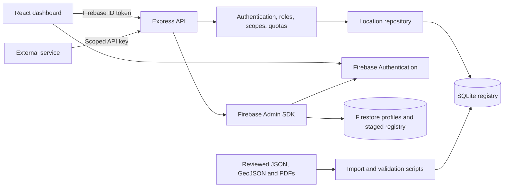

# System architecture

## Purpose

Any Location turns country-specific administrative hierarchies into searchable maps, stable reference codes, governed edits, and reusable APIs. Uganda is the first complete implementation; additional countries can define different names and numbers of levels without changing the database schema.

## Component view



## Runtime responsibilities

| Component | Responsibility |
| --- | --- |
| React/Vite | Maps, hierarchy navigation, administration, API client management, and account UI |
| Express | API routing, JSON errors, request IDs, security headers, authentication, authorization, quotas, and exports |
| SQLite | Current complete local hierarchy, reference codes, paths, geometry links, leaders, audit events, API clients, and usage records |
| Firebase Authentication | Human registration, sign-in, verification, password recovery, and identity tokens |
| Firestore | User profiles and staged location synchronization under Spark-plan limits |
| Firebase Admin SDK | Trusted role claims, account management, and controlled imports |

SQLite appearing in local logs is intentional. It is the validated operational registry for the current single-host application. Firestore is not silently treated as complete until all reviewed batches are imported and verified.

## Request flow

1. A human signs in with Firebase, or a machine sends an owner-issued API key.
2. The server creates an authenticated principal.
3. Policy checks role, API permission, country/economic-zone/regional-block scope, and selected location subtrees.
4. Machine requests consume per-minute and daily quota.
5. Write requests require permission; machine writes also require an idempotency key.
6. The repository applies hierarchy constraints transactionally and appends audit history.
7. The API returns a structured response with `X-Request-Id`.

## Location hierarchy model

Every country has ordered hierarchy-level definitions. Locations form an adjacency tree and a closure table accelerates ancestor and descendant queries.

```text
Country root
└── Country-defined level 1
    └── Country-defined level 2
        └── ...
```

Uganda currently uses:

```text
Country > Region > District/City > County/Municipality/Constituency
        > Sub-county/Division/Town Council > Parish/Ward > Village/Cell/Zone
```

The external identity is `referenceCode`; it remains stable when a name changes. `uid` is the internal UUID used by relational tables.

## Geographic API scopes

A service client selects exactly one boundary type:

- economic zone;
- regional block;
- one or more countries; or
- specific location roots and every descendant beneath them.

Permissions such as `locations:read` and `geometry:read` are separate from geography. Both checks must pass.

## Data authority

- Active hierarchy: complete reviewed registry seeded from the current accepted source edition.
- Candidate edition: newer but incomplete or unreconciled material available for review, not automatic replacement.
- Supporting data: geometry, pcodes, aliases, and crosswalk evidence that enriches but does not override the hierarchy.
- Historical evidence: retained audits and source documents.

See [the database model](location-database.md) and [Uganda reconciliation](../data/uganda-2025-reconciliation.md).

## Scalability boundaries

The current design is suitable for a Spark-compatible, single-host deployment. Before running multiple API instances, move rate-limit state and webhook delivery to shared infrastructure and migrate SQLite to a managed relational database while preserving UUIDs, reference codes, hierarchy paths, and API contracts.
